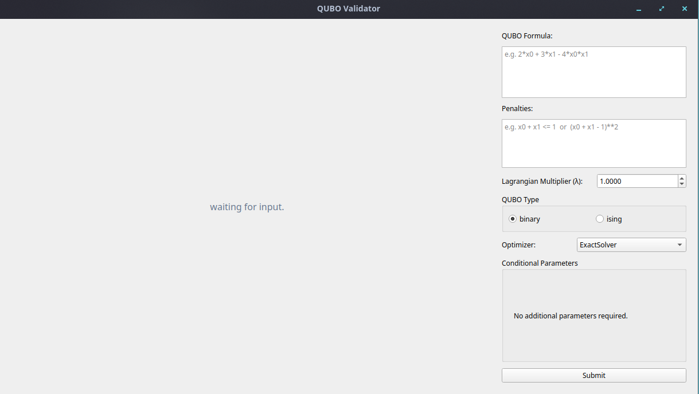
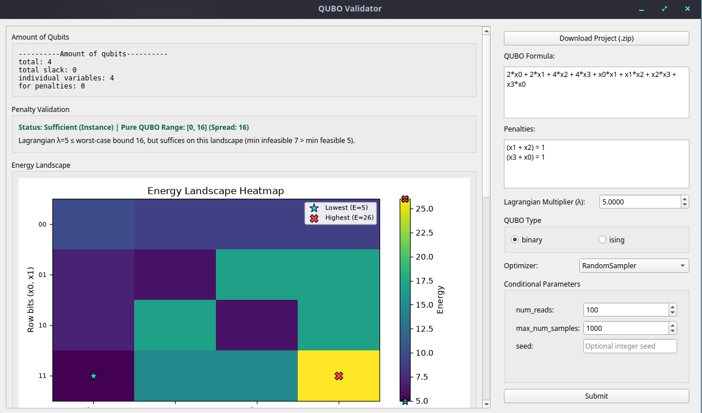

# QUBO Validator





QUBO validator is a python application meant to help quantum researchers to validate their QUBO formulations.

The main idea is that a researcher could place its formulation on a simple GUI application and retrieve information about:

- amount of qubits
- energy landscape
- the connectivity graph
- whether its Lagrangian terms are enough
- amount of slack terms

This project was made in python using PySide6 and Dwave-ocean-sdk.


## Running

To run this project, we recommend using `uv` as a virtual environment manager, but you can use `pip` as well.


```bash
# --DEPENDENCIES--
## uv
uv sync --no-dev
## pip
pip install -r requirements.txt

## --DEV DEPENDENCIES--
## uv
uv sync --only-dev
## pip
pip install -r dev-requirement.txt

# --RUN--
## uv
uv run qubo-validator
## python
python src/qubo_validator/qubo_validator.py
## make
make run

# --TESTING--
## uv
uv run python -m pytest -s -vvv ./tests
## python
python -m pytest -s -vvv ./tests
## make
make test

## --LINTING--
## uv
uv run ruff --check -fix
## make
make lint
```


